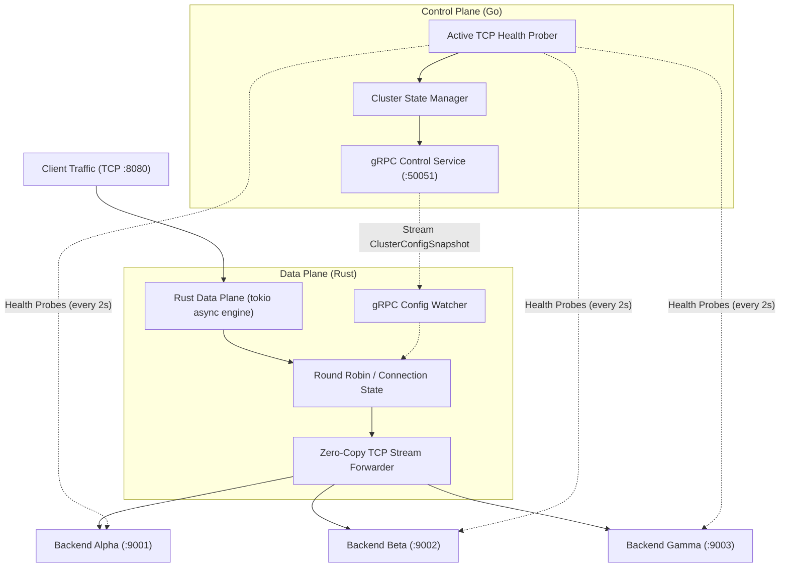

# Cloud-Native Distributed L4 Proxy & Health Controller


A modern, high-performance L4 load balancer architecture built using **Rust** for the low-level data plane and **Go** for the distributed control plane.

Designed following modern datacenter and infrastructure paradigms (similar to Envoy, Katran, and Cilium), this project decouples performance-critical packet/stream forwarding from cluster topology coordination and health probing.

---

## 🏛️ System Architecture



---

## 💡 Key Design Decisions & Trade-offs

| Component | Language | Rationale | Trade-offs Considered |
| :--- | :--- | :--- | :--- |
| **Data Plane** | **Rust** | Zero-cost abstractions, non-blocking asynchronous I/O via Tokio, guaranteed memory safety without garbage collection (GC) pauses, highly deterministic p99/p99.9 latencies. | Higher development complexity and strict borrow-checker rules compared to Go. |
| **Control Plane** | **Go** | Rich concurrency model (`goroutines` + channels), rapid API and service development, native ecosystem for cloud-native orchestration and telemetry. | Minor GC overhead, but completely acceptable because it operates out-of-band from the raw network traffic path. |
| **IPC / Contract** | **Protocol Buffers v3 & gRPC** | Language-neutral binary serialization with bidirectional streaming capabilities. Single source of truth defined in `proto/service.proto`. | Requires build-time code generation (`protoc`, `tonic-build`). |

---

## 🚀 Key Features

* **Zero-Downtime Dynamic Reconfiguration:**
  The Rust Data Plane subscribes to real-time cluster configuration snapshots streamed by the Go Control Plane. Backend targets can join, drain, or drop out without restarting the proxy.
* **Active Health Probing:**
  The Go Control Plane continuously probes target endpoints with configurable intervals and timeouts. Unhealthy nodes are removed instantly from the routing pool.
* **Fault Tolerance & Resilient Reconnection:**
  If the Control Plane stops or restarts, the Data Plane continues serving traffic using its last known healthy configuration snapshot while executing backoff reconnection loops.
* **Efficient Bidirectional Forwarding:**
  Utilizes `tokio::io::copy_bidirectional` for asynchronous, non-blocking streaming between client and backend connections.

---

## 📁 Repository Structure

```text
├── proto/
│   └── service.proto            # Protobuf schema for RPC & telemetry contracts
├── dataplane/                   # Rust Data Plane (Engine)
│   ├── Cargo.toml
│   ├── build.rs                 # Compiles protobuf via tonic-build
│   └── src/
│       ├── balancer.rs          # Thread-safe load balancing algorithms
│       ├── controller_client.rs # gRPC client with auto-reconnect logic
│       ├── proxy.rs             # TCP forwarding loop & metric instrumentation
│       └── main.rs              # Application entrypoint & task orchestration
├── controlplane/                # Go Control Plane (Orchestrator)
│   ├── go.mod
│   ├── cmd/server/main.go       # Server entrypoint & graceful shutdown
│   ├── internal/health/         # Active TCP health checker
│   ├── internal/server/         # gRPC server implementation
│   └── pkg/api/v1/              # Generated Protobuf Go bindings
└── tools/
    └── mock_backend/main.go     # Lightweight test server to simulate target nodes
```

---

## 🛠️ Quickstart with Docker Compose (Recommended)

Run the entire cluster with a single command without installing Rust, Go, or Protoc on your host machine:

```bash
docker compose up --build
```

This starts:
* 3 Mock Backend targets (`backend-alpha`, `backend-beta`, `backend-gamma`)
* Go Control Plane (probing targets, streaming config via gRPC, and exposing Prometheus metrics on `:9090`)
* Rust Data Plane (listening on `http://127.0.0.1:8080/` and streaming telemetry)
* **Prometheus** (scraping metrics, accessible at `http://localhost:9091`)
* **Grafana** (pre-provisioned dashboard at `http://localhost:3000` — user: `admin`, pass: `admin`)

Test it immediately in another terminal:
```bash
# Test traffic forwarding
curl http://127.0.0.1:8080/

# Inspect raw Prometheus metrics
curl http://127.0.0.1:9090/metrics
```

Open your browser to view real-time live telemetry:
* **Grafana Dashboard:** [http://localhost:3000/d/proxy-cluster-overview](http://localhost:3000/d/proxy-cluster-overview)
* **Prometheus Targets:** [http://localhost:9091/targets](http://localhost:9091/targets)

To stop:
```bash
docker compose down
```

---

## 💻 Manual Local Development

### Prerequisites
* **Rust**: `1.80+` (`cargo`, `rustc`)
* **Go**: `1.22+`
* **Protoc**: Protocol Buffers Compiler (`protoc 3.x+`)

---

### Step-by-Step Running Guide

#### 1. Start Mock Backend Targets
Open 3 terminal sessions to run three mock backends:

```bash
# Terminal 1: Backend Alpha
go run tools/mock_backend/main.go -port 9001 -id backend-alpha

# Terminal 2: Backend Beta
go run tools/mock_backend/main.go -port 9002 -id backend-beta

# Terminal 3: Backend Gamma
go run tools/mock_backend/main.go -port 9003 -id backend-gamma
```

#### 2. Start the Go Control Plane
Open a 4th terminal:

```bash
cd controlplane
go run ./cmd/server
```
*The Control Plane starts active health checks on ports 9001, 9002, and 9003, and serves gRPC on port `:50051`.*

#### 3. Start the Rust Data Plane
Open a 5th terminal:

```bash
cd dataplane
cargo run
```
*The Data Plane connects to `127.0.0.1:50051`, receives the initial cluster snapshot, and starts accepting client connections on `127.0.0.1:8080`.*

#### 4. Test Traffic Forwarding
Send requests to the proxy:

```bash
curl http://127.0.0.1:8080/
curl http://127.0.0.1:8080/
curl http://127.0.0.1:8080/
```
*You will observe responses rotating across `backend-alpha`, `backend-beta`, and `backend-gamma` via Round Robin.*

#### 5. Test Live Failover / Self-Healing
Terminate one of the backend servers (e.g., stop `Backend Alpha` with `Ctrl+C`):
1. The Go Control Plane detects the TCP connect failure within 2 seconds.
2. An updated snapshot is immediately pushed to the Rust Data Plane.
3. Subsequent `curl` requests automatically distribute only across the remaining healthy backends without any downtime or errors.

---

## 📊 Automated Benchmarking & E2E Validation

The repository includes a built-in automated load tester and failover verification suite.

### 1. One-Command Automated Disaster Recovery & Failover Suite

This script starts all backends, control plane, and data plane, verifies baseline traffic distribution, kills a backend node, asserts self-healing failover with 0% error rate, and generates latency statistics:

* **On Windows (PowerShell):**
  ```powershell
  .\benchmarks\test_failover.ps1
  ```
* **On Linux / macOS (Bash):**
  ```bash
  chmod +x benchmarks/test_failover.sh
  ./benchmarks/test_failover.sh
  ```

### 2. Standalone Load Test & Latency Profiling

You can run targeted concurrent load tests directly against any running cluster:

```bash
go run tests/e2e/main.go -proxy http://127.0.0.1:8080 -requests 2000 -concurrency 50
```

#### Example Output:
```text
-------------------- BENCHMARK REPORT --------------------
 Total Duration    : 214.32ms
 Throughput (RPS)  : 9331.84 req/sec
 Total Requests    : 2000
 Successful        : 2000 (100.00%)
 Failed            : 0
 Latency Percentiles:
   - p50 (Median)  : 3.12ms
   - p95           : 7.84ms
   - p99           : 11.20ms

 Traffic Balancing Distribution:
   - backend-alpha  :   667 requests (33.3%)
   - backend-beta   :   667 requests (33.3%)
   - backend-gamma  :   666 requests (33.3%)
----------------------------------------------------------
```
